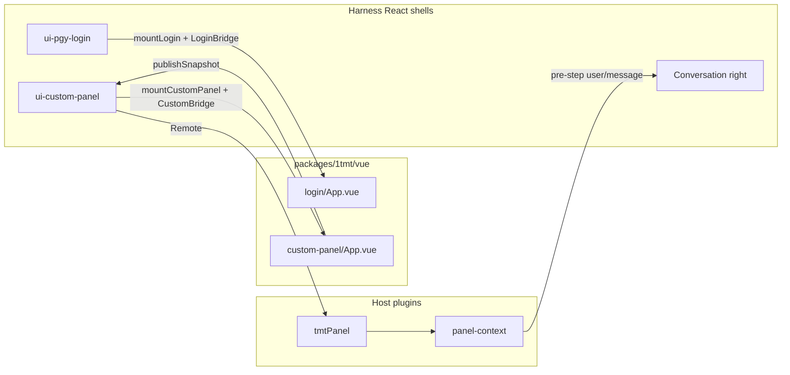

# 1tmt developer guide

English | [中文](README.zh.md)

## Summary

This page is for developers extending Harness on the 1tmt product line. It first explains **how Harness delivers context to the model** (hard rules and extension points), then explains the **custom-panel snapshot plugins** shipped in this work (purpose, split, data path), and finally covers day-to-day edits for the product UI (login / custom half-panel) and acceptance checks. 1tmt owns only two UI surfaces: the fullscreen WMS employee login and the left half-panel opened from the sidebar Custom entry. Both are Vue 3 + Element Plus islands under `packages/1tmt/vue`; the right-hand conversation and DeepSeek account login stay native Harness React.

## Table of Contents

- [How Harness reads context](#how-harness-reads-context)
- [These plugins: purpose and design](#these-plugins-purpose-and-design)
- [Boundaries: change / do not change](#boundaries-change--do-not-change)
- [Directory map](#directory-map)
- [Day-to-day workflow](#day-to-day-workflow)
- [Edit the login page](#edit-the-login-page)
- [Edit the custom half-panel](#edit-the-custom-half-panel)
- [Give Vue Host capabilities (Bridge)](#give-vue-host-capabilities-bridge)
- [Copy and locales](#copy-and-locales)
- [Acceptance checklist](#acceptance-checklist)
- [Related links](#related-links)

-----

<a id="how-harness-reads-context"></a>
## How Harness reads context

The most common mistake when building product UI is assuming the model can see the browser DOM or Vue component state. **It cannot.** Almost everything a model request may use comes from Host-side **Session log** events; the agent loop then projects provider history from that log.

### Hard rule: model-visible means logged

| Claim | Meaning |
|---|---|
| Model-visible means logged | Every model request must be reconstructable from the Session log; a new model-visible input requires a Session event |
| The Session log is the source of truth | `deriveMessages()` projects model history from the log; UI, Remotes, and tool results must land in durable events |
| The browser is not the model's eyes | Left-pane lists, forms, and DOM text that never reach the Host and log stay invisible to the conversation model |

Authoritative wording lives in [`docs/architecture.md`](../architecture.md) (Session log / Model-visible means logged). A parallel sample is [`packages/context/time-context`](../../packages/context/time-context/README.md), which appends a sourced `user/message` on `agent/pre-step`.

### When context enters a model request

Simplified timeline (architecture owns the full contract):

```text
User submits a prompt in the Web UI
  → Host opens / advances a turn
  → Assemble system prompt, tool schemas, …
  → agent/pre-step (waterfall)
       Listeners may rewrite/append user messages for this step, or reject
  → On enter, durable events such as user/message are appended
  → Derive model history from the log and call the LLM
  → Tool calls / results write back to the log for later steps
```

For “add business context for the model”, the main extension points are:

1. **`agent/pre-step` listeners** (preferred for per-step preparation): append or rewrite `UserMessage` values before the step enters; always `await next()` or the waterfall short-circuits.
2. **`agent.inject()`**: queue context for the next admitted request (see architecture “Where new behavior goes”).
3. **Tools**: the model pulls business data on demand; better for large payloads than stuffing every step's prompt.

Injected user-side messages usually carry a **`source`** (`MessageSourceMap` kind + `form`, e.g. `form: 'snapshot'`). UI, replay, and projections can then tell human input from plugin-injected context.

### Why “read the half-panel DOM” fails

| Approach | Problem |
|---|---|
| Playwright / Computer Use / screen scrape | Slow, brittle, unstructured; not the business source of truth |
| Vue state only, no Host publish | Model requests assemble on the Host; Client memory is invisible to the Agent |
| Hard-code the half-panel into `agent-loop` or Conversation | Breaks extension discipline; hard to disable or reuse |
| Dump full-page HTML into the system prompt | Noisy, cache-hostile, hard to maintain; still requires Session events to be compliant |

Correct path: **Vue publishes a structured snapshot → Host stores it → pre-step (or a tool) writes the Session → the model reads the log projection.**

### Relation to Cordis plugins

Almost every Harness capability is a Cordis plugin row (`cordis.yml` / `cordis.patch.yml`). Context injection is the same: a mountable / `disabled` Host plugin can turn “conversation reads the half-panel” on or off without changing the agent loop or removing the UI.

-----

<a id="these-plugins-purpose-and-design"></a>
## These plugins: purpose and design

### Purpose

When the left half-panel shows a list or an open bill form, and the user asks in the right-hand chat to “turn the current list into JSON”, the model should receive the **structured view currently displayed** — not guess, and not scrape the DOM.

Constraints:

- **Minimal Harness intrusion**: do not change the agent loop; do not bury logic in ui-layout / Conversation.
- **Independently removable**: half-panel UI and “inject into the model” stay decoupled; disable Host rows without tearing down the UI.
- **Structured publish**: list rows / form fields, not HTML.

### Two Host plugin rows + the existing Client shell

| Package | npm name | Role | Writes Session? |
|---|---|---|---|
| `packages/1tmt/panel` | `@deepseek-ai/dsh-1tmt-panel` | Host Remote `tmtPanel`: process-local latest snapshot | No (memory only) |
| `packages/1tmt/panel-context` | `@deepseek-ai/dsh-1tmt-panel-context` | `agent/pre-step` listener; appends durable `user/message` when the hash changes | Yes |
| `packages/client/ui-custom-panel` | `@deepseek-ai/dsh-client-ui-custom-panel` | React shell: wire `ctx.remote.tmtPanel` into `CustomBridge` | No (forward only) |
| `packages/1tmt/vue` | `@deepseek-ai/dsh-1tmt-vue` | Half-panel Vue: `publishSnapshot` when business data changes | No (Bridge only) |

`panel` and `panel-context` stay separate so you can keep storage without injection (e.g. a later read tool), or keep injection while swapping the store. That matches the mountable style of `time-context`.

### End-to-end data path

```mermaid
flowchart LR
  vue[Vue half-panel list/form]
  bridge[CustomBridge]
  remote[tmtPanel Remote]
  store[Host in-process snapshot + hash]
  prestep[panel-context pre-step]
  session[Session user/message]
  model[Next model request]

  vue -->|publishSnapshot structured| bridge
  bridge --> remote
  remote --> store
  store --> prestep
  prestep -->|write only when hash changes| session
  session -->|deriveMessages| model
```



Step by step:

1. **Vue** calls `bridge.publishSnapshot({ kind, title, rows, form? })` when the list/form changes (or when the placeholder mounts).
2. **Shell** `CustomPanelPage` forwards to `ctx.remote.tmtPanel.publishSnapshot` (Typert Remote, browser → Host).
3. **`dsh-1tmt-panel`** replaces the process-local “current snapshot” and computes a content `hash` (not on disk, not in the Session).
4. **`dsh-1tmt-panel-context`** on `agent/pre-step` reads `ctx.tmtPanel.getStored()`: if the snapshot is non-empty and its `hash` differs from the last injection for this Session, it appends a `user/message` with `source.kind: '1tmt-panel-context'` and `form: 'snapshot'`.
5. After the loop commits that message, this step and later projections include that context in the model history.

By default only a **summary** is injected (kind / title / items / hash). With `injectFullRows: true`, JSON rides along within `maxPayloadChars`; oversized payloads note the omission. Large bodies can later use a read-only tool (not shipped yet).

### Mount and disable

`packages/bundle/web-app/cordis.patch.yml` already mounts:

```yaml
- id: 1tmt-panel
  name: '@deepseek-ai/dsh-1tmt-panel'
- id: 1tmt-panel-context
  name: '@deepseek-ai/dsh-1tmt-panel-context'
  config:
    injectFullRows: false
    maxPayloadChars: 4000
```

On the Client, `dsh-api-remotes` mounts the generated `tmtPanel` remote; `ui-custom-panel` injects `remote.tmtPanel`.

Remove those two rows (or set `disabled: true`) and the half-panel UI still works, but the **conversation no longer auto-reads the snapshot** — that is the independent-plugin boundary.

### How product pages publish (developer contract)

```ts
await bridge.publishSnapshot({
  kind: 'list', // or 'form' | 'empty'
  title: 'Receive bills',
  rows: [
    { id: 1, billNo: 'RCV-001', qty: 10 },
    { id: 2, billNo: 'RCV-002', qty: 20 },
  ],
})

// When opening a bill editor:
await bridge.publishSnapshot({
  kind: 'form',
  title: 'Receive bill detail',
  rows: [],
  form: { id: 1, billNo: 'RCV-001', qty: 10 },
})
```

Conventions:

- Publish **structured fields** only (string / number / boolean / null); never HTML or Element instances.
- Publish again whenever the **user-visible** list or form changes; identical content yields the same hash and skips a second pre-step injection.
- On unmount, Vue/shell call `clearSnapshot()` so stale data does not linger in the process.

### Current limitations (package READMEs own detail)

- The snapshot is the **latest process-wide** value, not Session-keyed; Host restart drops it.
- No read-only tool yet; oversized payloads rely on the summary or a future tool.
- Package contracts: [`panel/README.md`](../../packages/1tmt/panel/README.md), [`panel-context/README.md`](../../packages/1tmt/panel-context/README.md).

### Do not

- Treat DOM / screenshots as the business truth
- Expect the model to “see” Vue state that never reaches the Host
- Change `agent-loop` or hard-code half-panel logic into Conversation
- Stuff full-page HTML into the system prompt

-----

<a id="boundaries-change--do-not-change"></a>
## Boundaries: change / do not change

| Scenario | Change here | Do not change |
|---|---|---|
| Employee login form / style / interaction | `packages/1tmt/vue/src/apps/login/` | `packages/client/ui-settings-account` (DeepSeek account login) |
| Left half-panel business page | `packages/1tmt/vue/src/apps/custom-panel/` | Conversation, sidebar chrome, settings body |
| Half-panel → model context | Vue `publishSnapshot` + the two Host plugins above | agent-loop, ui-layout, reading the DOM |
| Login backend / MCP | Bridge + `packages/api/pgy-login` (Host Remote) | `import` Cordis / `ctx` from Vue |
| Sidebar Custom label / icon | `packages/client/ui-custom-panel` (thin shell) | Migrate the whole app to Vue |

Architecture:



Vue obtains the Bridge with `inject('1tmtBridge')`. **Do not** depend on Cordis, React, or other `dsh-client-*` plugin implementations from the Vue package.

-----

<a id="directory-map"></a>
## Directory map

```
packages/1tmt/vue/                 # Product UI (npm: @deepseek-ai/dsh-1tmt-vue)
  src/bridge.ts                    # LoginBridge / CustomBridge types
  src/mount.ts                     # mountLogin / mountCustomPanel
  src/apps/login/App.vue           # Employee login (Element Plus)
  src/apps/custom-panel/App.vue    # Left half-panel; publishSnapshot on change
  types/index.d.ts                 # Public types for React shells

packages/1tmt/panel/               # Host Remote: snapshot store (ctx.tmtPanel)
packages/1tmt/panel-context/       # agent/pre-step: inject changed snapshots
packages/client/ui-pgy-login/      # Login shell: Bridge + mount/unmount
packages/client/ui-custom-panel/   # Half-panel shell: sidebar + Bridge → Remote
packages/api/pgy-login/            # Host Remote: orgs, WMS login, backend URL
packages/api/remotes/              # Client Remote assembly (includes tmtPanel)
docs/1tmt/README.md                # This guide
```

-----

<a id="day-to-day-workflow"></a>
## Day-to-day workflow

From the repository root:

```sh
# 1. After Vue edits: emit lib/index.js (prepare also runs on install)
pnpm --filter @deepseek-ai/dsh-1tmt-vue build

# 2. Bundle client shells (rebuild even for CSS/copy tweaks to avoid stale lib)
pnpm --filter @deepseek-ai/dsh-client-ui-pgy-login bundle
pnpm --filter @deepseek-ai/dsh-client-ui-custom-panel bundle

# 3. After panel Host source edits: tsc, then Host tsdown (emits typert remote)
pnpm exec tsc -b packages/1tmt/panel/tsconfig.host.json packages/1tmt/panel-context
pnpm exec tsdown --config-loader native --env.DSH_BUILD_FACE host

# 4. Launch (change port if 3080 is busy)
pnpm dsh web --no-open
# or: pnpm dsh web --port 3091 --no-open
```

If you only change Vue and the host already bundled once: repeat steps 1→2→refresh. `pnpm run dev:web` rebuilds client plugins; `dsh-1tmt-vue` `lib/` must still be fresh.

Focused tests:

```sh
pnpm exec vitest run packages/1tmt/vue/tests/mount.spec.ts
pnpm exec vitest run packages/1tmt/panel/tests
pnpm exec vitest run packages/1tmt/panel-context/tests
pnpm exec vitest run packages/client/ui-pgy-login/tests/login-overlay.client.spec.tsx
pnpm exec vitest run packages/client/ui-custom-panel/tests
```

-----

<a id="edit-the-login-page"></a>
## Edit the login page

1. Edit `packages/1tmt/vue/src/apps/login/App.vue` (form) and `app.css` (styles).
2. Use Element Plus in components; take copy from `bridge.labels.*`, do not hard-code Chinese (shell i18n owns product strings).
3. For new fields or APIs, extend `LoginBridge` first (next section), then call it from Vue.
4. `build` → `ui-pgy-login bundle` → `dsh web`, confirm the fullscreen gate is still Element Plus and **Settings DeepSeek account login is unchanged**.

Vue drives the flow: `status` → (optional) backend URL → `listOrganizations` → `wmsLogin` → `refreshSessions` → `onLoggedIn()`. The React shell tears down the portal on success.

Settings “backend / RuoYi” and sidebar sign-out stay in `ui-pgy-login` React components; this cut does not move them to Vue.

-----

<a id="edit-the-custom-half-panel"></a>
## Edit the custom half-panel

1. Put business UI in `packages/1tmt/vue/src/apps/custom-panel/App.vue` (and CSS beside it).
2. Sidebar Custom opens AppFrame with this page on the left and native Conversation on the right (panel id = `custom`).
3. Sidebar label/icon: `packages/client/ui-custom-panel/src/client/locales.ts`, `CustomPanelIcon.tsx`.
4. For Host / Remote / session access: extend `CustomBridge`; `CustomPanelPage.tsx` injects from `ctx` (`publishSnapshot` / `clearSnapshot` already exist).
5. Call `bridge.publishSnapshot(...)` after list/form changes so the next pre-step can see them (see “These plugins” above).

The placeholder publishes a demo list on mount and shows `published hash=…` for end-to-end checks.

-----

<a id="give-vue-host-capabilities-bridge"></a>
## Give Vue Host capabilities (Bridge)

Vue **must not** touch `ctx`. The path is:

1. Add methods/fields in `packages/1tmt/vue/src/bridge.ts` and `types/index.d.ts` (keep both aligned).
2. Assemble the Bridge in the shell:
   - Login: `packages/client/ui-pgy-login/src/client/LoginOverlay.tsx` (and `inject` in `index.ts`)
   - Half-panel: `packages/client/ui-custom-panel/src/client/CustomPanelPage.tsx` (add `inject` deps when needed)
3. If the capability does not exist yet: implement a Host Remote first (e.g. `pgy-login`, `1tmt-panel`), wire the shell, and mount the Client remote in `dsh-api-remotes`.
4. In Vue: `const bridge = inject<YourBridge>('1tmtBridge')` and call only the Bridge.

`BridgeResult<T>` mirrors Typert `RemoteResult`: `{ ok: true, value }` / `{ ok: false, error: { message } }`. Shells may forward Remote results to Vue as-is.

-----

<a id="copy-and-locales"></a>
## Copy and locales

| Copy | File |
|---|---|
| Login labels (passed into Vue) | `packages/client/ui-pgy-login/src/client/locales.ts` |
| Half-panel title/intro, sidebar Custom, republish | `packages/client/ui-custom-panel/src/client/locales.ts` |

Vue reads `bridge.labels` only; do not hard-code product copy in `.vue` files.

-----

<a id="acceptance-checklist"></a>
## Acceptance checklist

- [ ] `pnpm --filter @deepseek-ai/dsh-1tmt-vue build` succeeds
- [ ] `ui-pgy-login` / `ui-custom-panel` host `bundle` succeeds
- [ ] Host has `packages/1tmt/panel/lib/typert.remote-client.js` (Remote generated)
- [ ] `dsh web`: fullscreen employee login is Element Plus (DevTools: `.el-card` / `style#dsh-1tmt-element-plus`)
- [ ] After login, Custom opens left Vue + right native chat; half-panel shows `published hash=…`
- [ ] Asking “turn the current list into JSON” in chat references the demo list (`1tmt-panel-context` mounted)
- [ ] With `1tmt-panel-context` `disabled: true`: half-panel remains, new turns no longer auto-include the snapshot summary
- [ ] Settings → DeepSeek account entry stays native Harness (not the Element Plus employee login)

-----

<a id="related-links"></a>
## Related links

- Architecture (model-visible / pre-step): [`docs/architecture.md`](../architecture.md)
- Group map: [`packages/1tmt/README.md`](../../packages/1tmt/README.md)
- Vue package: [`packages/1tmt/vue/README.md`](../../packages/1tmt/vue/README.md)
- Snapshot Remote: [`packages/1tmt/panel/README.md`](../../packages/1tmt/panel/README.md)
- pre-step injection: [`packages/1tmt/panel-context/README.md`](../../packages/1tmt/panel-context/README.md)
- Sample `time-context`: [`packages/context/time-context/README.md`](../../packages/context/time-context/README.md)
- Web Client shell: [`docs/subsystems/web-client.md`](../subsystems/web-client.md)
- RuoYi MCP / WMS login integration: [`docs/1tmt-ruoyi-wms-integration.md`](../1tmt-ruoyi-wms-integration.md)
- Integration commit notes: [`docs/1tmt-pgy-version-notes.md`](../1tmt-pgy-version-notes.md)
- RuoYi MCP tools live in the RuoYi repo under `1tmt-kde-pgy` (separate from this UI / context guide)
