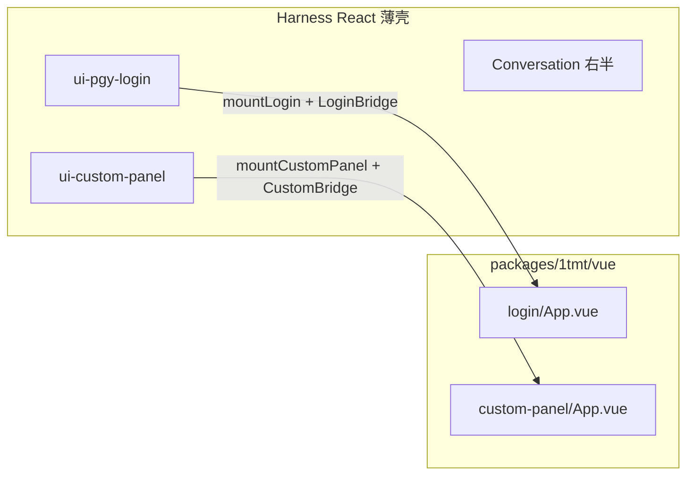

# 1tmt 自研 UI 开发指南

## Summary

1tmt 只自研两块界面：全屏 **WMS 员工登录**、侧栏「自定义按钮」打开后的 **左半屏业务区**。二者用 Vue 3 + Element Plus（MIT）写在 `packages/1tmt/vue`；右侧对话、侧栏壳、设置、DeepSeek 账户登录仍是 Harness 原生 React，不要改。

## Table of Contents

- [边界：改什么 / 不改什么](#边界改什么--不改什么)
- [目录速查](#目录速查)
- [日常开发流程](#日常开发流程)
- [改登录页](#改登录页)
- [改自定义半屏](#改自定义半屏)
- [给 Vue 增加 Host 能力（Bridge）](#给-vue-增加-host-能力bridge)
- [文案与多语言](#文案与多语言)
- [验收清单](#验收清单)
- [相关链接](#相关链接)

-----

<a id="边界改什么--不改什么"></a>
## 边界：改什么 / 不改什么

| 场景 | 改这里 | 不要改 |
|---|---|---|
| 员工登录表单 / 样式 / 交互 | `packages/1tmt/vue/src/apps/login/` | `packages/client/ui-settings-account`（DeepSeek 账户登录） |
| 左半屏业务页 | `packages/1tmt/vue/src/apps/custom-panel/` | Conversation、侧栏框架、设置页主体 |
| 登录调后端 / MCP | Bridge + `packages/api/pgy-login`（Host Remote） | 直接在 Vue 里 `import` Cordis / `ctx` |
| 侧栏「自定义按钮」图标、入口文案 | `packages/client/ui-custom-panel`（薄壳） | 把整站迁到 Vue |

架构关系：



Vue 内通过 `inject('1tmtBridge')` 拿 Bridge；**禁止**在 Vue 工程依赖 Cordis、React 或其它 `dsh-client-*` 插件实现。

-----

<a id="目录速查"></a>
## 目录速查

```
packages/1tmt/vue/                 # 自研 UI 唯一主战场（npm: @deepseek-ai/dsh-1tmt-vue）
  src/bridge.ts                    # LoginBridge / CustomBridge 类型
  src/mount.ts                     # mountLogin / mountCustomPanel
  src/apps/login/App.vue           # 员工登录（Element Plus）
  src/apps/custom-panel/App.vue    # 左半屏业务占位 → 在此扩展
  types/index.d.ts                 # 给 React 壳用的公开类型

packages/client/ui-pgy-login/      # 登录薄壳：拼 Bridge、挂载/卸载
packages/client/ui-custom-panel/   # 半屏薄壳：侧栏入口 + 挂载 Vue
packages/api/pgy-login/            # Host Remote：组织列表、WMS 登录、后端地址
docs/1tmt/README.md                # 本指南
```

-----

<a id="日常开发流程"></a>
## 日常开发流程

仓库根目录执行：

```sh
# 1. 改 Vue 后必做：产出 lib/index.js（install 时 prepare 也会跑）
pnpm --filter @deepseek-ai/dsh-1tmt-vue build

# 2. 把岛屿打进浏览器插件包（纯 CSS/文案微调也建议重打，避免旧 lib）
pnpm --filter @deepseek-ai/dsh-client-ui-pgy-login bundle
pnpm --filter @deepseek-ai/dsh-client-ui-custom-panel bundle

# 3. 启动（3080 占用时可换端口）
pnpm dsh web --no-open
# 或: pnpm dsh web --port 3091 --no-open
```

只改 Vue 源码、且宿主机已 `bundle` 过时：重复步骤 1→2→刷新浏览器即可。`pnpm run dev:web` 会重建 client 插件；仍须保证 `dsh-1tmt-vue` 的 `lib/` 是新的。

聚焦自测：

```sh
pnpm exec vitest run packages/1tmt/vue/tests/mount.spec.ts
pnpm exec vitest run packages/client/ui-pgy-login/tests/login-overlay.client.spec.tsx
pnpm exec vitest run packages/client/ui-custom-panel/tests/custom-panel-page.client.spec.tsx
```

-----

<a id="改登录页"></a>
## 改登录页

1. 编辑 `packages/1tmt/vue/src/apps/login/App.vue`（表单）和 `app.css`（样式）。
2. 组件里用 Element Plus；文案用 `bridge.labels.*`，不要写死中文（便于壳层 i18n）。
3. 需要新字段或新接口时，先扩 `LoginBridge`（见下一节），再在 Vue 里调用。
4. `build` → `ui-pgy-login bundle` → `dsh web`，确认全屏门仍是 Element Plus，且 **设置里的 DeepSeek 账户登录未变**。

登录流程由 Vue 驱动：`status` →（可选）后端地址 → `listOrganizations` → `wmsLogin` → `refreshSessions` → `onLoggedIn()`。成功后由 React 壳拆掉 portal。

设置页「后端 / 若依」与侧栏「退出登录」仍在 `ui-pgy-login` 的 React 组件里；本轮不迁 Vue。

-----

<a id="改自定义半屏"></a>
## 改自定义半屏

1. 业务 UI 写在 `packages/1tmt/vue/src/apps/custom-panel/App.vue`（及同目录 CSS）。
2. 侧栏点「自定义按钮」后，AppFrame 左半挂该页、右半仍是原生 Conversation（panel id = `custom`）。
3. 侧栏按钮文案/图标：`packages/client/ui-custom-panel/src/client/locales.ts`、`CustomPanelIcon.tsx`。
4. 需要调 Host / Remote / 会话时：扩展 `CustomBridge`，由 `CustomPanelPage.tsx` 从 `ctx` 注入（当前仅有 `labels`）。

-----

<a id="给-vue-增加-host-能力bridge"></a>
## 给 Vue 增加 Host 能力（Bridge）

Vue **不能**直接碰 `ctx`。正确路径：

1. 在 `packages/1tmt/vue/src/bridge.ts` 与 `types/index.d.ts` 增加方法/字段（两边保持一致）。
2. 在薄壳组装 Bridge：
   - 登录：`packages/client/ui-pgy-login/src/client/LoginOverlay.tsx`（及 `index.ts` 的 `inject`）
   - 半屏：`packages/client/ui-custom-panel/src/client/CustomPanelPage.tsx`（需要时给插件加 `inject` 依赖）
3. 若能力尚不存在：先在 `packages/api/pgy-login`（或其它 Host 包）实现 Remote，再接到薄壳。
4. Vue 内：`const bridge = inject<YourBridge>('1tmtBridge')`，只调用 Bridge。

`BridgeResult<T>` 与 Typert `RemoteResult` 对齐：`{ ok: true, value }` / `{ ok: false, error: { message } }`。薄壳可直接把 Remote 结果传给 Vue。

-----

<a id="文案与多语言"></a>
## 文案与多语言

| 文案位置 | 文件 |
|---|---|
| 登录 labels（传给 Vue） | `packages/client/ui-pgy-login/src/client/locales.ts` |
| 半屏标题/说明、侧栏「自定义按钮」 | `packages/client/ui-custom-panel/src/client/locales.ts` |

Vue 侧只读 `bridge.labels`，不要在 `.vue` 里硬编码产品文案。

-----

<a id="验收清单"></a>
## 验收清单

- [ ] `pnpm --filter @deepseek-ai/dsh-1tmt-vue build` 成功
- [ ] 两个 host `bundle` 成功（client.js 体积约含内联的 Vue/Element Plus）
- [ ] `dsh web`：全屏员工登录为 Element Plus（可用 DevTools 看 `.el-card` / `style#dsh-1tmt-element-plus`）
- [ ] 登录后点「自定义按钮」：左 Vue、右原生对话
- [ ] 设置 → DeepSeek 账户相关入口仍是 Harness 原样（未变成 Element Plus 员工登录）

-----

<a id="相关链接"></a>
## 相关链接

- 包契约：[`packages/1tmt/vue/README.md`](../../packages/1tmt/vue/README.md)
- 组说明：[`packages/1tmt/README.md`](../../packages/1tmt/README.md)
- Web Client 壳层：[`docs/subsystems/web-client.md`](../subsystems/web-client.md)
- 若依 MCP 工具在 RuoYi 仓库 `1tmt-kde-pgy`（与本 UI 文档分离）
