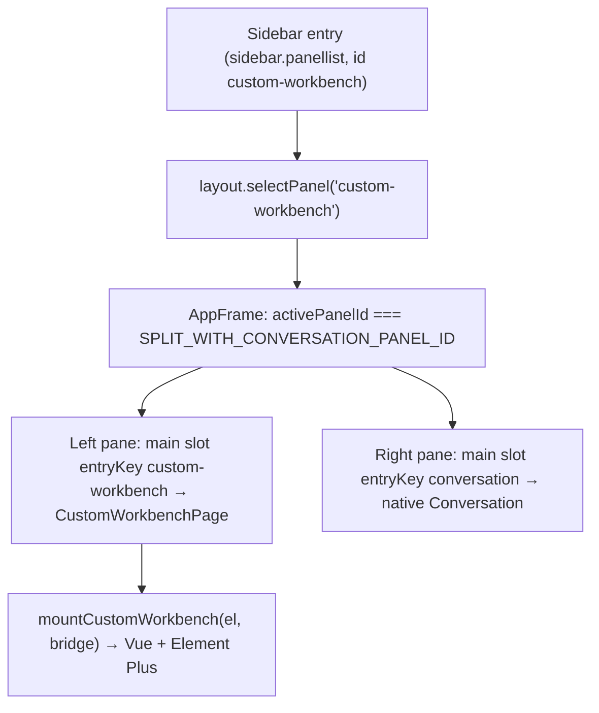
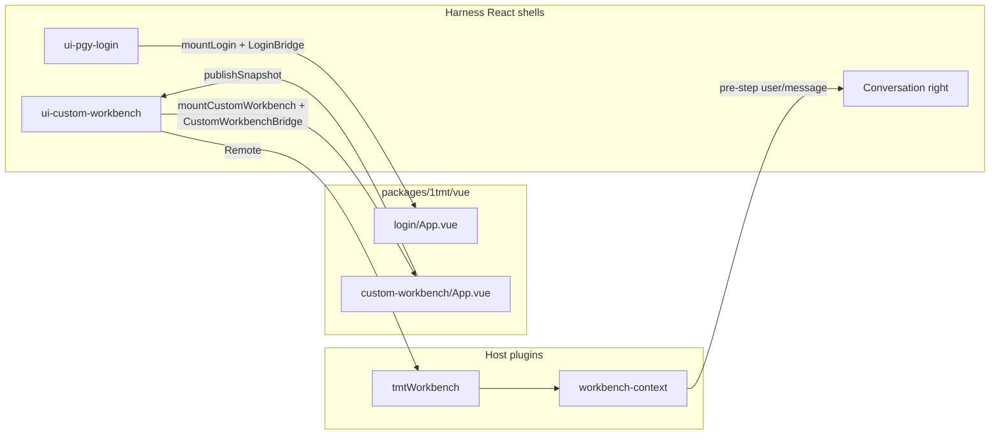

# 1tmt developer guide

English | [中文](README.zh.md)

## Summary

This page is for developers extending Harness on the 1tmt product line. It first explains what the **Custom Workbench** is, which plugins compose it, and how it works beside the conversation; then **how Harness delivers context to the model** (hard rules and extension points) and the purpose and data path of the **workbench snapshot plugins**; finally it covers day-to-day edits for the product UI (employee login / Custom Workbench) and acceptance checks. 1tmt owns only two UI surfaces: the fullscreen WMS employee login and the left business area opened from the sidebar Custom Workbench entry. Both are Vue 3 + Element Plus islands under `packages/1tmt/vue`; the right-hand conversation and DeepSeek account login stay native Harness React.

## Table of Contents

- [Custom Workbench: how it works](#custom-workbench-overview)
- [How Harness reads context](#how-harness-reads-context)
- [Workbench snapshot plugins: purpose and design](#workbench-snapshot-plugins-purpose-and-design)
- [Boundaries: change / do not change](#boundaries-change--do-not-change)
- [Directory map](#directory-map)
- [Day-to-day workflow](#day-to-day-workflow)
- [Edit the login page](#edit-the-login-page)
- [Edit the Custom Workbench](#edit-the-custom-workbench)
- [Give Vue Host capabilities (Bridge)](#give-vue-host-capabilities-bridge)
- [Copy and locales](#copy-and-locales)
- [Acceptance checklist](#acceptance-checklist)
- [Related links](#related-links)

-----

<a id="custom-workbench-overview"></a>
## Custom Workbench: how it works

The **Custom Workbench** is a sidebar entry. Opening it splits the main area: the left side is the 1tmt Vue business UI (lists, bill forms, and so on), and the right side is the native Harness conversation. The structured data currently shown on the left is published to the Host, and the conversation includes it automatically before the next model request, so the user can simply ask the right side to "tidy up the list on the left".

### Composition: four parts, one job each

| Part | Package / Loader row id | Runs in | Responsibility |
|---|---|---|---|
| Entry and shell | `@deepseek-ai/dsh-client-ui-custom-workbench` / `ui-custom-workbench` | Browser | Registers the sidebar entry and the main-area page; mounts the Vue island on the left; assembles Remote callbacks into `CustomWorkbenchBridge` |
| Business UI | `@deepseek-ai/dsh-1tmt-vue` (not a Loader row; inlined into the shell bundle) | Browser | Vue 3 + Element Plus page; calls `bridge.publishSnapshot` when data changes |
| Snapshot store | `@deepseek-ai/dsh-1tmt-workbench` / `1tmt-workbench` | Host | Typert Remote `tmtWorkbench`: keeps the latest snapshot in the Host process and computes its hash |
| Conversation injection | `@deepseek-ai/dsh-1tmt-workbench-context` / `1tmt-workbench-context` | Host | `agent/pre-step` listener: appends a sourced `user/message` to the Session when the snapshot changes |

The first two decide what the user sees; the last two decide what the conversation can read. They interact only through the Bridge and the Remote, so each can be disabled separately (see the switch matrix below).

### From the sidebar click to the split view



1. **Registration**: in its browser `apply`, `ui-custom-workbench` calls `ctx.slots.register` twice: once into `sidebar.panellist` (icon and the "Custom Workbench" label), and once into the `main` slot under the panel id `custom-workbench` (page component `CustomWorkbenchPage`). Both registrations are effects, so disposing the plugin removes them and the entry disappears.
2. **Selection**: clicking the sidebar entry makes `ui-sidebar` call `ctx.layout.selectPanel('custom-workbench')`, which sets `activePanelId` in the root layout store.
3. **Split**: `ui-layout`'s `AppFrame` sees that `activePanelId` equals `SPLIT_WITH_CONVERSATION_PANEL_ID` (value `custom-workbench`) and renders two `main` slots at once: `custom-workbench` on the left, `conversation` on the right, roughly half each. Other main panels (plugin page, settings-like pages) still replace the conversation entirely.
4. **Switching conversations keeps the split**: when `ui-workspace` navigation reveals a conversation while the Custom Workbench split is active, it keeps the split and swaps only the right-hand conversation; other full-takeover panels return to the plain conversation.
5. **Mounting Vue**: `CustomWorkbenchPage` renders an empty host `div` and calls `mountCustomWorkbench(el, bridge)` from `@deepseek-ai/dsh-1tmt-vue` in a `useEffect`. The Vue app receives the Bridge through `provide('1tmtBridge', bridge)` and installs Element Plus; Element Plus and workbench styles are injected once as `<style id="dsh-1tmt-element-plus">` / `<style id="dsh-1tmt-custom-workbench">`. Leaving the workbench unmounts the React component, and `unmountCustomWorkbench(el)` destroys the Vue app and clears the host node.

Vue never touches the Cordis `ctx`: the Bridge alone defines what it can do (`labels` copy, `publishSnapshot`, `clearSnapshot`). The shell's `inject` turns `ctx.remote.tmtWorkbench` methods into Bridge callbacks and folds Remote failures into `{ ok: false, error: { message } }` for Vue.

### Lifecycle

| When | What happens |
|---|---|
| Open the Custom Workbench | Vue mounts; the placeholder immediately publishes a demo list with `publishSnapshot` and shows `published hash=…` |
| Left-side data changes | The business page publishes again; the Host replaces the old snapshot and the hash follows the content |
| The right side sends the next message | `workbench-context` compares hashes on pre-step and appends a `user/message` only when the hash differs from this Session's last injection |
| Leave the Custom Workbench | Vue calls `clearSnapshot()` on unmount; the Host clears the snapshot and later steps inject nothing |
| Host restarts | The snapshot lives only in memory and is lost; injection messages already in the Session stay in the log |

### Switch matrix: what disabling each row does

Add `disabled: true` to the row in `packages/bundle/web-app/cordis.patch.yml` and restart `dsh web`:

| Disabled row | Sidebar entry / left UI | Does the conversation read workbench data? |
|---|---|---|
| `ui-custom-workbench` | Gone (slot registrations are disposed with the plugin) | No; no page publishes snapshots |
| `1tmt-workbench-context` | Works | No; the Host still stores the snapshot, but no listener writes it into the Session |
| `1tmt-workbench` | Still shown; the browser `remote.tmtWorkbench` is mounted from generated descriptors, but the Host has no matching methods and the page shows `publish failed: …` | No; `workbench-context` also stays pending without the `tmtWorkbench` service |

To keep the UI while hiding it from the model, disable only `1tmt-workbench-context`.

-----

<a id="how-harness-reads-context"></a>
## How Harness reads context

The most common mistake when building product UI is assuming the model can see the browser DOM or Vue component state. **It cannot.** Almost everything a model request may use comes from Host-side **Session log** events; the agent loop then projects provider history from that log.

### Hard rule: model-visible means logged

| Claim | Meaning |
|---|---|
| Model-visible means logged | Every model request must be reconstructable from the Session log; a new model-visible input requires a Session event |
| The Session log is the source of truth | `deriveMessages()` projects model history from the log; UI, Remotes, and tool results must land in durable events |
| The browser is not the model's eyes | Lists, forms, and DOM text in the Custom Workbench that never reach the Host and log stay invisible to the conversation model |

Authoritative wording lives in [`docs/architecture.md`](../architecture.md) (Session log / Model-visible means logged). A parallel sample is [`packages/context/time-context`](../../packages/context/time-context/README.md), which appends a sourced `user/message` on `agent/pre-step`.

### When context enters a model request

Simplified timeline (architecture owns the full contract):

```text
User submits a prompt in the Web UI
  → Host opens / advances a turn
  → Assemble system prompt, tool schemas, …
  → agent/pre-step (waterfall)
       Listeners may rewrite/append user messages for this step, or reject
  → On enter, durable events such as user/message are appended
  → Derive model history from the log and call the LLM
  → Tool calls / results write back to the log for later steps
```

For “add business context for the model”, the main extension points are:

1. **`agent/pre-step` listeners** (preferred for per-step preparation): append or rewrite `UserMessage` values before the step enters; always `await next()` or the waterfall short-circuits.
2. **`agent.inject()`**: queue context for the next admitted request (see architecture “Where new behavior goes”).
3. **Tools**: the model pulls business data on demand; better for large payloads than stuffing every step's prompt.

Injected user-side messages usually carry a **`source`** (`MessageSourceMap` kind + `form`, e.g. `form: 'snapshot'`). UI, replay, and projections can then tell human input from plugin-injected context.

### Why “read the workbench DOM” fails

| Approach | Problem |
|---|---|
| Playwright / Computer Use / screen scrape | Slow, brittle, unstructured; not the business source of truth |
| Vue state only, no Host publish | Model requests assemble on the Host; Client memory is invisible to the Agent |
| Hard-code the workbench into `agent-loop` or Conversation | Breaks extension discipline; hard to disable or reuse |
| Dump full-page HTML into the system prompt | Noisy, cache-hostile, hard to maintain; still requires Session events to be compliant |

Correct path: **Vue publishes a structured snapshot → Host stores it → pre-step (or a tool) writes the Session → the model reads the log projection.**

### Relation to Cordis plugins

Almost every Harness capability is a Cordis plugin row (`cordis.yml` / `cordis.patch.yml`). Context injection is the same: a mountable / `disabled` Host plugin can turn “conversation reads the workbench” on or off without changing the agent loop or removing the UI.

-----

<a id="workbench-snapshot-plugins-purpose-and-design"></a>
## Workbench snapshot plugins: purpose and design

### Purpose

When the Custom Workbench shows a list or an open bill form, and the user asks in the right-hand chat to “turn the current list into JSON”, the model should receive the **structured view currently displayed** — not guess, and not scrape the DOM.

Constraints:

- **Minimal Harness intrusion**: do not change the agent loop or Conversation; ui-layout / ui-workspace share only one split panel id.
- **Independently removable**: workbench UI and “inject into the model” stay decoupled; disable the Host injection row without tearing down the UI.
- **Structured publish**: list rows / form fields, not HTML.

### Two Host plugin rows + the browser shell

| Package | npm name | Role | Writes Session? |
|---|---|---|---|
| `packages/1tmt/workbench` | `@deepseek-ai/dsh-1tmt-workbench` | Host Remote `tmtWorkbench`: process-local latest snapshot | No (memory only) |
| `packages/1tmt/workbench-context` | `@deepseek-ai/dsh-1tmt-workbench-context` | `agent/pre-step` listener; appends durable `user/message` when the hash changes | Yes |
| `packages/client/ui-custom-workbench` | `@deepseek-ai/dsh-client-ui-custom-workbench` | React shell: wire `ctx.remote.tmtWorkbench` into `CustomWorkbenchBridge` | No (forward only) |
| `packages/1tmt/vue` | `@deepseek-ai/dsh-1tmt-vue` | Workbench Vue: `publishSnapshot` when business data changes | No (Bridge only) |

`workbench` and `workbench-context` stay separate so you can keep storage without injection (e.g. a later read tool), or keep injection while swapping the store. That matches the mountable style of `time-context`.

### End-to-end data path

```mermaid
flowchart LR
  vue[Vue custom workbench list/form]
  bridge[CustomWorkbenchBridge]
  remote[tmtWorkbench Remote]
  store[Host in-process snapshot + hash]
  prestep[workbench-context pre-step]
  session[Session user/message]
  model[Next model request]

  vue -->|publishSnapshot structured| bridge
  bridge --> remote
  remote --> store
  store --> prestep
  prestep -->|write only when hash changes| session
  session -->|deriveMessages| model
```



Step by step:

1. **Vue** calls `bridge.publishSnapshot({ kind, title, rows, form? })` when the list/form changes (or when the placeholder mounts).
2. **Shell** `CustomWorkbenchPage` forwards to `ctx.remote.tmtWorkbench.publishSnapshot` (Typert Remote, browser → Host).
3. **`dsh-1tmt-workbench`** replaces the process-local “current snapshot” and computes a content `hash` (not on disk, not in the Session).
4. **`dsh-1tmt-workbench-context`** on `agent/pre-step` reads `ctx.tmtWorkbench.getStored()`: if the snapshot is non-empty and its `hash` differs from the last injection for this Session, it appends a `user/message` with `source.kind: '1tmt-workbench-context'` and `form: 'snapshot'`. The Session projection `tmtWorkbenchContext` folds the last injected hash from the log, so replay and restarts reach the same decision.
5. After the loop commits that message, this step and later projections include that context in the model history.

By default only a **summary** is injected (kind / title / items / hash); the model sees text such as `Custom workbench snapshot (kind=list, title="…", items=2, hash=…).`. With `injectFullRows: true`, JSON rides along within `maxPayloadChars`; oversized payloads note the omission. Large bodies can later use a read-only tool (not shipped yet).

### Mount and disable

`packages/bundle/web-app/cordis.patch.yml` already mounts:

```yaml
- id: 1tmt-workbench
  name: '@deepseek-ai/dsh-1tmt-workbench'
- id: 1tmt-workbench-context
  name: '@deepseek-ai/dsh-1tmt-workbench-context'
  config:
    injectFullRows: false
    maxPayloadChars: 4000
```

On the Client, `dsh-api-remotes` mounts the generated `tmtWorkbench` remote; `ui-custom-workbench` injects `remote.tmtWorkbench`.

Disable `1tmt-workbench-context` (or set `disabled: true`) and the workbench UI still works, but the **conversation no longer auto-reads the snapshot** — that is the independent-plugin boundary. The [switch matrix](#custom-workbench-overview) lists every row's effect.

### How product pages publish (developer contract)

```ts
await bridge.publishSnapshot({
  kind: 'list', // or 'form' | 'empty'
  title: 'Receive bills',
  rows: [
    { id: 1, billNo: 'RCV-001', qty: 10 },
    { id: 2, billNo: 'RCV-002', qty: 20 },
  ],
})

// When opening a bill editor:
await bridge.publishSnapshot({
  kind: 'form',
  title: 'Receive bill detail',
  rows: [],
  form: { id: 1, billNo: 'RCV-001', qty: 10 },
})
```

Conventions:

- Publish **structured fields** only (string / number / boolean / null); never HTML or Element instances.
- Publish again whenever the **user-visible** list or form changes; identical content yields the same hash and skips a second pre-step injection.
- On leaving the workbench, Vue/shell call `clearSnapshot()` so stale data does not linger in the process.

### Current limitations (package READMEs own detail)

- The snapshot is the **latest process-wide** value, not Session-keyed; Host restart drops it.
- No read-only tool yet; oversized payloads rely on the summary or a future tool.
- Package contracts: [`workbench/README.md`](../../packages/1tmt/workbench/README.md), [`workbench-context/README.md`](../../packages/1tmt/workbench-context/README.md).

### Do not

- Treat DOM / screenshots as the business truth
- Expect the model to “see” Vue state that never reaches the Host
- Change `agent-loop` or hard-code workbench logic into Conversation
- Stuff full-page HTML into the system prompt

-----

<a id="boundaries-change--do-not-change"></a>
## Boundaries: change / do not change

| Scenario | Change here | Do not change |
|---|---|---|
| Employee login form / style / interaction | `packages/1tmt/vue/src/apps/login/` | `packages/client/ui-settings-account` (DeepSeek account login) |
| Custom Workbench business page | `packages/1tmt/vue/src/apps/custom-workbench/` | Conversation, sidebar chrome, settings body |
| Workbench → model context | Vue `publishSnapshot` + the two Host plugins above | agent-loop, ui-layout, reading the DOM |
| Login backend / MCP | Bridge + `packages/api/pgy-login` (Host Remote) | `import` Cordis / `ctx` from Vue |
| Sidebar Custom Workbench label / icon | `packages/client/ui-custom-workbench` (thin shell) | Migrate the whole app to Vue |

Architecture:



Vue obtains the Bridge with `inject('1tmtBridge')`. **Do not** depend on Cordis, React, or other `dsh-client-*` plugin implementations from the Vue package.

-----

<a id="directory-map"></a>
## Directory map

```
packages/1tmt/vue/                     # Product UI (npm: @deepseek-ai/dsh-1tmt-vue)
  src/bridge.ts                        # LoginBridge / CustomWorkbenchBridge types
  src/mount.ts                         # mountLogin / mountCustomWorkbench
  src/apps/login/App.vue               # Employee login (Element Plus)
  src/apps/custom-workbench/App.vue    # Custom workbench; publishSnapshot on change
  types/index.d.ts                     # Public types for React shells

packages/1tmt/workbench/               # Host Remote: snapshot store (ctx.tmtWorkbench)
packages/1tmt/workbench-context/       # agent/pre-step: inject changed snapshots
packages/client/ui-pgy-login/          # Login shell: Bridge + mount/unmount
packages/client/ui-custom-workbench/   # Workbench shell: sidebar + Bridge → Remote
packages/api/pgy-login/                # Host Remote: orgs, WMS login, backend URL
packages/api/remotes/                  # Client Remote assembly (includes tmtWorkbench)
docs/1tmt/README.md                    # This guide
```

-----

<a id="day-to-day-workflow"></a>
## Day-to-day workflow

From the repository root:

```sh
# 1. After Vue edits: emit lib/index.js (prepare also runs on install)
pnpm --filter @deepseek-ai/dsh-1tmt-vue build

# 2. Bundle client shells (rebuild even for CSS/copy tweaks to avoid stale lib)
pnpm --filter @deepseek-ai/dsh-client-ui-pgy-login bundle
pnpm --filter @deepseek-ai/dsh-client-ui-custom-workbench bundle

# 3. After workbench Host source edits: tsc, then Host tsdown (emits typert remote)
pnpm exec tsc -b packages/1tmt/workbench/tsconfig.host.json packages/1tmt/workbench-context
pnpm exec tsdown --config-loader native --env.DSH_BUILD_FACE host

# 4. Launch (change port if 3080 is busy)
pnpm dsh web --no-open
# or: pnpm dsh web --port 3091 --no-open
```

If you only change Vue and the host already bundled once: repeat steps 1→2→refresh. `pnpm run dev:web` rebuilds client plugins; `dsh-1tmt-vue` `lib/` must still be fresh.

Focused tests:

```sh
pnpm exec vitest run packages/1tmt/vue/tests/mount.spec.ts
pnpm exec vitest run packages/1tmt/workbench/tests
pnpm exec vitest run packages/1tmt/workbench-context/tests
pnpm exec vitest run packages/client/ui-pgy-login/tests/login-overlay.client.spec.tsx
pnpm exec vitest run packages/client/ui-custom-workbench/tests
```

-----

<a id="edit-the-login-page"></a>
## Edit the login page

1. Edit `packages/1tmt/vue/src/apps/login/App.vue` (form) and `app.css` (styles).
2. Use Element Plus in components; take copy from `bridge.labels.*`, do not hard-code Chinese (shell i18n owns product strings).
3. For new fields or APIs, extend `LoginBridge` first (next section), then call it from Vue.
4. `build` → `ui-pgy-login bundle` → `dsh web`, confirm the fullscreen gate is still Element Plus and **Settings DeepSeek account login is unchanged**.

Vue drives the flow: `status` → (optional) backend URL → `listOrganizations` → `wmsLogin` → `refreshSessions` → `onLoggedIn()`. The React shell tears down the portal on success.

Settings “Harness platform” and sidebar sign-out stay in `ui-pgy-login` React components; this cut does not move them to Vue.

-----

<a id="edit-the-custom-workbench"></a>
## Edit the Custom Workbench

1. Put business UI in `packages/1tmt/vue/src/apps/custom-workbench/` (`App.vue`, `stk-input.ts`, CSS). **Add new modules only as home-screen icon entries** (tap an icon to enter the module full-page, like the RuoYi-App workbench); do not register more `sidebar.panellist` entries.
2. The sidebar keeps a single 1tmt business entry, Custom Workbench; AppFrame splits left/right (panel id = `custom-workbench`; see [how it works](#custom-workbench-overview)). The workbench opens on an icon home screen; tap Purchase inbound to enter segmented pages (bill list, lines, barcodes). A barcode matches by receive-bill id and entry id, then selects that line.
3. Sidebar label/icon: `packages/client/ui-custom-workbench/src/client/locales.ts`, `CustomWorkbenchIcon.tsx`.
4. Host capabilities via Bridge: `publishSnapshot` / `clearSnapshot` (`tmtWorkbench`) and purchase-inbound `listBills` / `viewBill` / `entityOutputs` / `getBarcode` / `getStockInfo` / `submitReport` (`pgyPurReceive`, MCP only).
5. Call `bridge.publishSnapshot(...)` after list/bill changes so the next pre-step can see them (see “Workbench snapshot plugins” above).

Purchase-inbound path: list receive bills → open detail (View + entity outputs) → enter stock code / barcode manually → confirm inbound synchronously (no PDA queue, no developer mode). DTO assembly lives in Vue `stk-input.ts`.

-----

<a id="give-vue-host-capabilities-bridge"></a>
## Give Vue Host capabilities (Bridge)

Vue **must not** touch `ctx`. The path is:

1. Add methods/fields in `packages/1tmt/vue/src/bridge.ts` and `types/index.d.ts` (keep both aligned).
2. Assemble the Bridge in the shell:
   - Login: `packages/client/ui-pgy-login/src/client/LoginOverlay.tsx` (and `inject` in `index.ts`)
   - Workbench: `packages/client/ui-custom-workbench/src/client/CustomWorkbenchPage.tsx` (add `inject` deps when needed)
3. If the capability does not exist yet: implement a Host Remote first (e.g. `pgy-login`, `1tmt-workbench`), wire the shell, and mount the Client remote in `dsh-api-remotes`.
4. In Vue: `const bridge = inject<YourBridge>('1tmtBridge')` and call only the Bridge.

`BridgeResult<T>` mirrors Typert `RemoteResult`: `{ ok: true, value }` / `{ ok: false, error: { message } }`. Shells may forward Remote results to Vue as-is.

-----

<a id="copy-and-locales"></a>
## Copy and locales

| Copy | File |
|---|---|
| Login labels (passed into Vue) | `packages/client/ui-pgy-login/src/client/locales.ts` |
| Workbench title, sidebar Custom Workbench, purchase-inbound copy | `packages/client/ui-custom-workbench/src/client/locales.ts` (namespace `customWorkbench`) |

Vue reads `bridge.labels` only; do not hard-code product copy in `.vue` files.

-----

<a id="acceptance-checklist"></a>
## Acceptance checklist

- [ ] `pnpm --filter @deepseek-ai/dsh-1tmt-vue build` succeeds
- [ ] `ui-pgy-login` / `ui-custom-workbench` host `bundle` succeeds
- [ ] Host has `packages/1tmt/workbench/lib/typert.remote-client.js` (Remote generated)
- [ ] `dsh web`: fullscreen employee login is Element Plus (DevTools: `.el-card` / `style#dsh-1tmt-element-plus`)
- [ ] After login, Custom Workbench opens left Vue (Purchase → Purchase inbound) + right native chat; list queries call `publishSnapshot`
- [ ] Purchase inbound: search → open → enter barcode → confirm inbound (needs RuoYi MCP + Kingdee)
- [ ] Asking about the current list in chat can reference the workbench snapshot (`1tmt-workbench-context` mounted)
- [ ] With `1tmt-workbench-context` `disabled: true`: the workbench remains, new turns no longer auto-include the snapshot summary
- [ ] Settings → built-in plugins lists `1tmt-workbench`, `1tmt-workbench-context`, and `ui-custom-workbench` as active
- [ ] Settings → DeepSeek account entry stays native Harness (not the Element Plus employee login)

-----

<a id="related-links"></a>
## Related links

- Architecture (model-visible / pre-step): [`docs/architecture.md`](../architecture.md)
- Group map: [`packages/1tmt/README.md`](../../packages/1tmt/README.md)
- Vue package: [`packages/1tmt/vue/README.md`](../../packages/1tmt/vue/README.md)
- Snapshot Remote: [`packages/1tmt/workbench/README.md`](../../packages/1tmt/workbench/README.md)
- pre-step injection: [`packages/1tmt/workbench-context/README.md`](../../packages/1tmt/workbench-context/README.md)
- Browser shell: [`packages/client/ui-custom-workbench/README.md`](../../packages/client/ui-custom-workbench/README.md)
- Sample `time-context`: [`packages/context/time-context/README.md`](../../packages/context/time-context/README.md)
- Web Client shell: [`docs/subsystems/web-client.md`](../subsystems/web-client.md)
- RuoYi MCP / WMS login integration: [`docs/1tmt-ruoyi-wms-integration.md`](../1tmt-ruoyi-wms-integration.md)
- Integration commit notes: [`docs/1tmt-pgy-version-notes.md`](../1tmt-pgy-version-notes.md)
- RuoYi MCP tools live in the RuoYi repo under `1tmt-kde-pgy` (separate from this UI / context guide)
