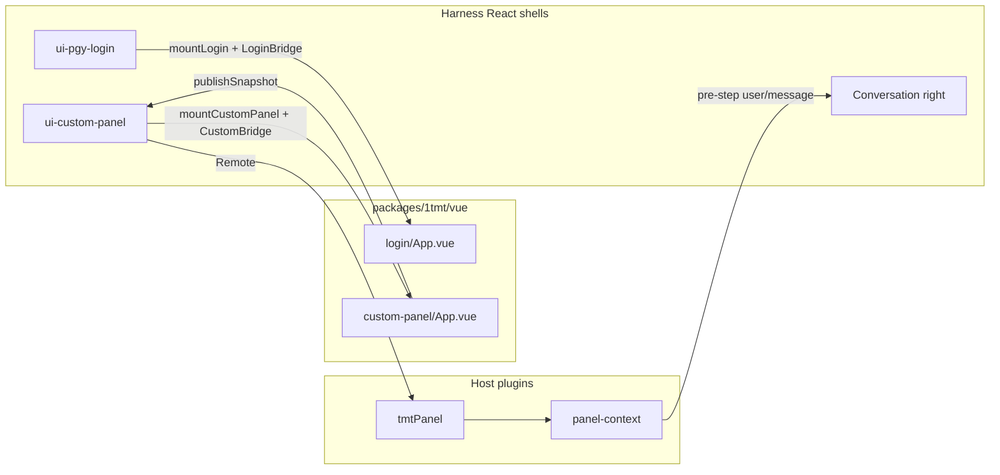

# 1tmt 开发指南

[English](README.md) | 中文

## Summary

本文面向在 1tmt 产品线上扩展 Harness 的开发者。先说明 **Harness 如何把上下文交给模型**（硬规则与扩展点），再说明本次落地的 **半屏快照插件**（目的、拆分、数据路径），最后给出自研 UI（登录 / 自定义半屏）的日常改法与验收。1tmt 只自研两块界面：全屏 WMS 员工登录、侧栏「自定义按钮」打开后的左半屏业务区；二者用 Vue 3 + Element Plus 写在 `packages/1tmt/vue`，右侧对话与 DeepSeek 账户登录仍是 Harness 原生 React。

## Table of Contents

- [Harness 上下文读取：工作原理](#how-harness-reads-context)
- [本次插件：目的与原理](#these-plugins-purpose-and-design)
- [边界：改什么 / 不改什么](#boundaries-change--do-not-change)
- [目录速查](#directory-map)
- [日常开发流程](#day-to-day-workflow)
- [改登录页](#edit-the-login-page)
- [改自定义半屏](#edit-the-custom-half-panel)
- [给 Vue 增加 Host 能力（Bridge）](#give-vue-host-capabilities-bridge)
- [文案与多语言](#copy-and-locales)
- [验收清单](#acceptance-checklist)
- [相关链接](#related-links)

-----

<a id="how-harness-reads-context"></a>
## Harness 上下文读取：工作原理

开发业务 UI 时最容易误判的一点是：**模型看不到浏览器 DOM，也看不到 Vue 组件内存里的 state。** 模型每一轮请求里能用的材料，几乎全部来自 Host 侧已经写入 **Session 日志** 的事件；Agent 循环再从日志投影出发给提供商的消息历史。

### 硬规则：模型可见 ⟺ 已写入 Session 日志

| 说法 | 含义 |
|---|---|
| Model-visible means logged | 每一轮模型请求必须能从 Session 日志重建；新增「要让模型看见」的输入，必须对应 Session 事件 |
| Session 日志是真相源 | `deriveMessages()` 从日志投影模型历史；UI、Remote、工具结果最终都要落到可持久化的事件上 |
| 浏览器不是模型的眼睛 | 左半屏列表、表单、DOM 文本若不上报 Host、不进日志，右半对话里的模型永远「不知道」 |

权威表述见 [`docs/architecture.md`](../architecture.zh.md)（Session log / Model-visible means logged）。对照样例：[`packages/context/time-context`](../../packages/context/time-context/README.zh.md) 在 `agent/pre-step` 里追加带 `source` 的 `user/message`。

### 一轮对话里，上下文何时进入模型请求

简化时序（细节以 architecture 为准）：

```text
User submits a prompt in the Web UI
  → Host opens / advances a turn
  → Assemble system prompt, tool schemas, …
  → agent/pre-step (waterfall)
       Listeners may rewrite/append user messages for this step, or reject
  → On enter, durable events such as user/message are appended
  → Derive model history from the log and call the LLM
  → Tool calls / results write back to the log for later steps
```

对「给模型加一段业务上下文」而言，官方扩展点主要是：

1. **`agent/pre-step` 监听器**（推荐用于「每步准备时注入」）：在进入本步前追加或改写 `UserMessage`；返回前必须 `await next()`，否则会掐断 waterfall。
2. **`agent.inject()`**：把上下文排进下一轮被 admit 的请求（见 architecture「Where new behavior goes」）。
3. **工具（tools）**：模型主动调用时再读业务数据；适合大数据、按需拉取，而不是把整页塞进每轮 prompt。

注入的用户侧消息通常带 **`source`**（`MessageSourceMap` 声明的 kind + `form`，例如 `form: 'snapshot'`）。这样 UI、回放、投影都能区分「真人输入」与「插件注入的上下文」。

### 为什么不能「直接读半屏 DOM」

| 做法 | 问题 |
|---|---|
| Playwright / Computer Use 读屏幕 | 慢、脆、非结构化；不是业务真相源 |
| 只改 Vue state，不写 Host | 模型请求组装在 Host；Client 内存对 Agent 不可见 |
| 改 `agent-loop` 或 Conversation 写死半屏 | 破坏扩展点纪律，难卸载、难复用 |
| 把整页 HTML 塞进 system prompt | 噪声大、缓存差、难维护；且仍须有 Session 事件才合规 |

正确方向：**Vue 上报结构化快照 → Host 保存 → 在 pre-step（或 tool）写入 Session → 模型从日志投影读到。**

### 和 Cordis 插件的关系

Harness 几乎所有能力都是 Cordis 插件行（`cordis.yml` / `cordis.patch.yml`）。上下文注入也不例外：做成可挂载/可 `disabled` 的 Host 插件后，卸掉插件行即可关掉「对话读半屏」，而不必改 agent-loop 或拆掉半屏 UI。

-----

<a id="these-plugins-purpose-and-design"></a>
## 本次插件：目的与原理

### 目的

左半屏展示列表或打开单据表单时，用户在右半对话说「把现在列表整理成 JSON」之类请求，模型应能拿到**当前展示的结构化数据**再回答——而不是猜、也不是读 DOM。

约束：

- **对 Harness 源码侵入尽量小**：不改 agent-loop，不塞进 ui-layout / Conversation。
- **独立可卸**：半屏 UI 与「是否注入模型」解耦；卸掉 Host 插件后 UI 仍可用。
- **结构化上报**：列表行 / 表单字段，不是 HTML。

### 拆成两行 Host 插件 + 现有 Client 薄壳

| 包 | npm 名 | 职责 | 是否写 Session |
|---|---|---|---|
| `packages/1tmt/panel` | `@deepseek-ai/dsh-1tmt-panel` | Host Remote `tmtPanel`：进程内保存最新快照 | 否（只存内存） |
| `packages/1tmt/panel-context` | `@deepseek-ai/dsh-1tmt-panel-context` | 监听 `agent/pre-step`，在 hash 变化时追加 durable `user/message` | 是 |
| `packages/client/ui-custom-panel` | `@deepseek-ai/dsh-client-ui-custom-panel` | React 薄壳：把 `ctx.remote.tmtPanel` 打成 `CustomBridge` | 否（只转发） |
| `packages/1tmt/vue` | `@deepseek-ai/dsh-1tmt-vue` | 半屏 Vue：在业务数据变化时 `publishSnapshot` | 否（只调用 Bridge） |

`panel` 与 `panel-context` 分开，是为了：只想存快照、以后用 tool 拉全量时，可以关掉 context 注入；或反过来只关注入、保留 Remote。对齐 `time-context` 的「独立挂载」习惯。

### 端到端数据路径

```mermaid
flowchart LR
  vue[Vue half-panel list/form]
  bridge[CustomBridge]
  remote[tmtPanel Remote]
  store[Host in-process snapshot + hash]
  prestep[panel-context pre-step]
  session[Session user/message]
  model[Next model request]

  vue -->|publishSnapshot structured| bridge
  bridge --> remote
  remote --> store
  store --> prestep
  prestep -->|write only when hash changes| session
  session -->|deriveMessages| model
```



逐步说明：

1. **Vue** 在列表/表单变化（或占位页挂载）时调用 `bridge.publishSnapshot({ kind, title, rows, form? })`。
2. **薄壳** `CustomPanelPage` 把调用转到 `ctx.remote.tmtPanel.publishSnapshot`（Typert Remote，浏览器 → Host）。
3. **`dsh-1tmt-panel`** 在 Host 进程内替换「当前快照」，并计算 content `hash`（不落盘、不写 Session）。
4. **`dsh-1tmt-panel-context`** 在 `agent/pre-step` 里读取 `ctx.tmtPanel.getStored()`：若快照非空且 `hash` 与本 Session 上次注入不同，则追加一条 `source.kind: '1tmt-panel-context'`、`form: 'snapshot'` 的 `user/message`。
5. Agent 循环把该消息写入 Session 后，本步及后续投影到模型请求的历史里就会包含这段上下文。

默认只注入**摘要**（kind / title / items / hash）。`injectFullRows: true` 时在 `maxPayloadChars` 内附带 JSON；超限则注明省略。大数据按需再走只读 tool（尚未实现）。

### 挂载与卸载

`packages/bundle/web-app/cordis.patch.yml` 已挂：

```yaml
- id: 1tmt-panel
  name: '@deepseek-ai/dsh-1tmt-panel'
- id: 1tmt-panel-context
  name: '@deepseek-ai/dsh-1tmt-panel-context'
  config:
    injectFullRows: false
    maxPayloadChars: 4000
```

Client 侧：`dsh-api-remotes` 挂载生成的 `tmtPanel` remote；`ui-custom-panel` 已注入 `remote.tmtPanel`。

卸掉上述两行（或 `disabled: true`）后：半屏 UI 仍可展示，但**对话不再自动读到快照**——这就是「独立插件」边界。

### 业务页如何上报（开发契约）

```ts
await bridge.publishSnapshot({
  kind: 'list', // or 'form' | 'empty'
  title: 'Receive bills',
  rows: [
    { id: 1, billNo: 'RCV-001', qty: 10 },
    { id: 2, billNo: 'RCV-002', qty: 20 },
  ],
})

// When opening a bill editor:
await bridge.publishSnapshot({
  kind: 'form',
  title: 'Receive bill detail',
  rows: [],
  form: { id: 1, billNo: 'RCV-001', qty: 10 },
})
```

约定：

- 只传**结构化字段**（字符串 / 数字 / 布尔 / null），不要传 HTML 或 Element 实例。
- 列表或表单**每次用户可见内容变化**后发布；相同内容重复发布会得到相同 hash，pre-step 不会重复注入。
- 卸载半屏时薄壳/Vue 会 `clearSnapshot()`，避免旧数据残留在进程里。

### 当前限制（读包 README 获取细节）

- 快照是**进程内最新一份**，未按 Session 分桶；Host 重启丢失。
- 尚无只读 tool；超大 payload 依赖摘要或日后 tool。
- 包契约：[`panel/README.md`](../../packages/1tmt/panel/README.zh.md)、[`panel-context/README.md`](../../packages/1tmt/panel-context/README.zh.md)。

### 不要做（再次强调）

- 用读 DOM / 截图当业务真相
- 只改 Vue state 却期望模型「看见」
- 改 `agent-loop` 或把半屏逻辑写死进 Conversation
- 把整页 HTML 塞进 system prompt

-----

<a id="boundaries-change--do-not-change"></a>
## 边界：改什么 / 不改什么

| 场景 | 改这里 | 不要改 |
|---|---|---|
| 员工登录表单 / 样式 / 交互 | `packages/1tmt/vue/src/apps/login/` | `packages/client/ui-settings-account`（DeepSeek 账户登录） |
| 左半屏业务页 | `packages/1tmt/vue/src/apps/custom-panel/` | Conversation、侧栏框架、设置页主体 |
| 半屏 → 模型上下文 | Vue `publishSnapshot` + 上表两个 Host 插件 | agent-loop、ui-layout、读 DOM |
| 登录调后端 / MCP | Bridge + `packages/api/pgy-login`（Host Remote） | 直接在 Vue 里 `import` Cordis / `ctx` |
| 侧栏「自定义按钮」图标、入口文案 | `packages/client/ui-custom-panel`（薄壳） | 把整站迁到 Vue |

架构关系：



Vue 内通过 `inject('1tmtBridge')` 拿 Bridge；**禁止**在 Vue 工程依赖 Cordis、React 或其它 `dsh-client-*` 插件实现。

-----

<a id="directory-map"></a>
## 目录速查

```
packages/1tmt/vue/                 # Product UI (npm: @deepseek-ai/dsh-1tmt-vue)
  src/bridge.ts                    # LoginBridge / CustomBridge types
  src/mount.ts                     # mountLogin / mountCustomPanel
  src/apps/login/App.vue           # Employee login (Element Plus)
  src/apps/custom-panel/App.vue    # Left half-panel; publishSnapshot on change
  types/index.d.ts                 # Public types for React shells

packages/1tmt/panel/               # Host Remote: snapshot store (ctx.tmtPanel)
packages/1tmt/panel-context/       # agent/pre-step: inject changed snapshots
packages/client/ui-pgy-login/      # Login shell: Bridge + mount/unmount
packages/client/ui-custom-panel/   # Half-panel shell: sidebar + Bridge → Remote
packages/api/pgy-login/            # Host Remote: orgs, WMS login, backend URL
packages/api/remotes/              # Client Remote assembly (includes tmtPanel)
docs/1tmt/README.md                # This guide
```

-----

<a id="day-to-day-workflow"></a>
## 日常开发流程

仓库根目录执行：

```sh
# 1. After Vue edits: emit lib/index.js (prepare also runs on install)
pnpm --filter @deepseek-ai/dsh-1tmt-vue build

# 2. Bundle client shells (rebuild even for CSS/copy tweaks to avoid stale lib)
pnpm --filter @deepseek-ai/dsh-client-ui-pgy-login bundle
pnpm --filter @deepseek-ai/dsh-client-ui-custom-panel bundle

# 3. After panel Host source edits: tsc, then Host tsdown (emits typert remote)
pnpm exec tsc -b packages/1tmt/panel/tsconfig.host.json packages/1tmt/panel-context
pnpm exec tsdown --config-loader native --env.DSH_BUILD_FACE host

# 4. Launch (change port if 3080 is busy)
pnpm dsh web --no-open
# or: pnpm dsh web --port 3091 --no-open
```

只改 Vue 源码、且宿主机已 `bundle` 过时：重复步骤 1→2→刷新浏览器即可。`pnpm run dev:web` 会重建 client 插件；仍须保证 `dsh-1tmt-vue` 的 `lib/` 是新的。

聚焦自测：

```sh
pnpm exec vitest run packages/1tmt/vue/tests/mount.spec.ts
pnpm exec vitest run packages/1tmt/panel/tests
pnpm exec vitest run packages/1tmt/panel-context/tests
pnpm exec vitest run packages/client/ui-pgy-login/tests/login-overlay.client.spec.tsx
pnpm exec vitest run packages/client/ui-custom-panel/tests
```

-----

<a id="edit-the-login-page"></a>
## 改登录页

1. 编辑 `packages/1tmt/vue/src/apps/login/App.vue`（表单）和 `app.css`（样式）。
2. 组件里用 Element Plus；文案用 `bridge.labels.*`，不要写死中文（便于壳层 i18n）。
3. 需要新字段或新接口时，先扩 `LoginBridge`（见下一节），再在 Vue 里调用。
4. `build` → `ui-pgy-login bundle` → `dsh web`，确认全屏门仍是 Element Plus，且 **设置里的 DeepSeek 账户登录未变**。

登录流程由 Vue 驱动：`status` →（可选）后端地址 → `listOrganizations` → `wmsLogin` → `refreshSessions` → `onLoggedIn()`。成功后由 React 壳拆掉 portal。

设置页「后端 / 若依」与侧栏「退出登录」仍在 `ui-pgy-login` 的 React 组件里；本轮不迁 Vue。

-----

<a id="edit-the-custom-half-panel"></a>
## 改自定义半屏

1. 业务 UI 写在 `packages/1tmt/vue/src/apps/custom-panel/App.vue`（及同目录 CSS）。
2. 侧栏点「自定义按钮」后，AppFrame 左半挂该页、右半仍是原生 Conversation（panel id = `custom`）。
3. 侧栏按钮文案/图标：`packages/client/ui-custom-panel/src/client/locales.ts`、`CustomPanelIcon.tsx`。
4. 需要调 Host / Remote / 会话时：扩展 `CustomBridge`，由 `CustomPanelPage.tsx` 从 `ctx` 注入（已有 `publishSnapshot` / `clearSnapshot`）。
5. 列表或表单变化后调用 `bridge.publishSnapshot(...)`，对话侧才会在下一轮 pre-step 读到（原理见上文「本次插件」）。

占位页挂载时会发布演示列表并显示 `published hash=…`，便于联调「对话是否读到半屏」。

-----

<a id="give-vue-host-capabilities-bridge"></a>
## 给 Vue 增加 Host 能力（Bridge）

Vue **不能**直接碰 `ctx`。正确路径：

1. 在 `packages/1tmt/vue/src/bridge.ts` 与 `types/index.d.ts` 增加方法/字段（两边保持一致）。
2. 在薄壳组装 Bridge：
   - 登录：`packages/client/ui-pgy-login/src/client/LoginOverlay.tsx`（及 `index.ts` 的 `inject`）
   - 半屏：`packages/client/ui-custom-panel/src/client/CustomPanelPage.tsx`（需要时给插件加 `inject` 依赖）
3. 若能力尚不存在：先在 Host 包实现 Remote（如 `pgy-login`、`1tmt-panel`），再接到薄壳；Client Remote 需在 `dsh-api-remotes` 挂载。
4. Vue 内：`const bridge = inject<YourBridge>('1tmtBridge')`，只调用 Bridge。

`BridgeResult<T>` 与 Typert `RemoteResult` 对齐：`{ ok: true, value }` / `{ ok: false, error: { message } }`。薄壳可直接把 Remote 结果传给 Vue。

-----

<a id="copy-and-locales"></a>
## 文案与多语言

| 文案位置 | 文件 |
|---|---|
| 登录 labels（传给 Vue） | `packages/client/ui-pgy-login/src/client/locales.ts` |
| 半屏标题/说明、侧栏「自定义按钮」、重新发布 | `packages/client/ui-custom-panel/src/client/locales.ts` |

Vue 侧只读 `bridge.labels`，不要在 `.vue` 里硬编码产品文案。

-----

<a id="acceptance-checklist"></a>
## 验收清单

- [ ] `pnpm --filter @deepseek-ai/dsh-1tmt-vue build` 成功
- [ ] `ui-pgy-login` / `ui-custom-panel` 两个 host `bundle` 成功
- [ ] Host 侧存在 `packages/1tmt/panel/lib/typert.remote-client.js`（Remote 已生成）
- [ ] `dsh web`：全屏员工登录为 Element Plus（可用 DevTools 看 `.el-card` / `style#dsh-1tmt-element-plus`）
- [ ] 登录后点「自定义按钮」：左 Vue、右原生对话；半屏显示 `published hash=…`
- [ ] 在右半对话提问「把现在列表整理成 JSON」：模型能引用演示列表（需 `1tmt-panel-context` 已挂载）
- [ ] 将 `1tmt-panel-context` 设为 `disabled: true` 后：半屏仍在，但新对话不再自动带上快照摘要
- [ ] 设置 → DeepSeek 账户相关入口仍是 Harness 原样（未变成 Element Plus 员工登录）

-----

<a id="related-links"></a>
## 相关链接

- 架构（模型可见 / pre-step）：[`docs/architecture.md`](../architecture.zh.md)
- 组说明：[`packages/1tmt/README.md`](../../packages/1tmt/README.zh.md)
- Vue 包契约：[`packages/1tmt/vue/README.md`](../../packages/1tmt/vue/README.zh.md)
- 快照 Remote：[`packages/1tmt/panel/README.md`](../../packages/1tmt/panel/README.zh.md)
- pre-step 注入：[`packages/1tmt/panel-context/README.md`](../../packages/1tmt/panel-context/README.zh.md)
- 对照样例 time-context：[`packages/context/time-context/README.md`](../../packages/context/time-context/README.zh.md)
- Web Client 壳层：[`docs/subsystems/web-client.md`](../subsystems/web-client.zh.md)
- 若依 MCP / WMS 登录集成：[`docs/1tmt-ruoyi-wms-integration.md`](../1tmt-ruoyi-wms-integration.zh.md)
- 集成提交说明：[`docs/1tmt-pgy-version-notes.md`](../1tmt-pgy-version-notes.zh.md)
- 若依 MCP 工具在 RuoYi 仓库 `1tmt-kde-pgy`（与本 UI / 上下文文档分离）
